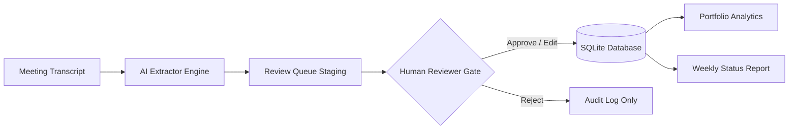
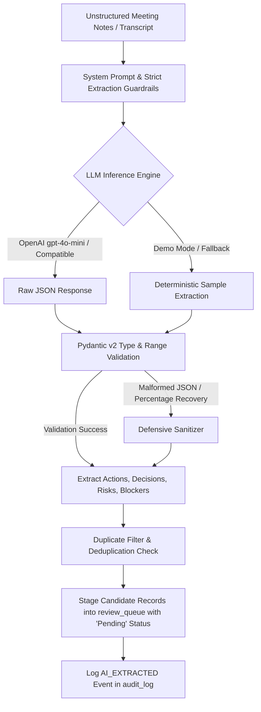

# MEETFLOW AI — AI Meeting Intelligence & Initiative Tracker

[](https://www.python.org/)
[](https://streamlit.io/)
[](https://www.sqlalchemy.org/)
[](https://docs.pydantic.dev/)
[](LICENSE)

**MeetFlow AI** is a production-grade enterprise operational intelligence system that converts unstructured meeting notes and audio transcripts into structured, verifiable deliverables. Designed around an uncompromising **Human-in-the-Loop (HITL) governance gate**, MeetFlow AI ensures that AI suggestions are never blindly committed to official records, preventing phantom tasks, hallucinated deadlines, and accountability gaps.

---

## 🎯 Problem

In modern organizations, strategic decisions and tactical commitments are made during meetings, yet execution frequently falters due to systemic process gaps:
1. **Meeting Amnesia & Task Loss:** Upwards of 40% of action items agreed upon in cross-functional standups and reviews are lost in chat threads, shared docs, or personal notes.
2. **AI Hallucination & Phantom Commitments:** Unconstrained LLM tools frequently invent deliverables, misattribute owners, fabricate unrealistic deadlines, or convert casual conversation into urgent tasks.
3. **Accountability Disconnect:** Traditional task management tools (Jira, Asana, Linear) lack explicit traceability back to the verbatim conversational context where commitments were made.
4. **Executive Visibility Void:** Leadership lacks real-time, consolidated portfolio visibility into which strategic initiatives are on track, blocked, or accumulating overdue delivery risk.

---

## 💼 Business Value

MeetFlow AI transforms fragmented conversational discussions into auditable strategic execution:
- **Zero Commitment Slippage:** Automates extraction of critical action items, decisions, risks, and blockers, ensuring no verbal commitment is lost.
- **Enterprise Governance & Trust:** Guarantees data integrity by enforcing a strict staging gate—every candidate task requires human authorization, review, or rejection before official registration.
- **Executive Decision Velocity:** Real-time portfolio dashboards provide C-suite and product leaders with immediate health visibility across active strategic programs.
- **Operational Reporting Automation:** Replaces hours of manual status compilation with automated weekly executive briefings generated in Markdown, CSV, and HTML.
- **Auditability & Compliance:** Provides full data lineage (`AI Generated → Human Edited → Approved/Rejected → Live Tracker`) for complete regulatory and operational transparency.

---

## 🏗️ Architecture

MeetFlow AI follows a strict, unidirectional governance pipeline:

```
Meeting Transcript
       ↓
LLM Extraction Engine (Pydantic Schema + Verbatim Citation Guardrails)
       ↓
Review Queue [Staging Barrier] (Zero Unverified DB Mutation)
       ↓
Human Verification Gate (Approve / Edit / Reject)
       ↓
SQLite Persistent Database (Tasks + Immutable Audit Logs)
       ↓
Portfolio Analytics Engine (Initiative Health, Overdue SLAs, Velocity)
       ↓
Weekly Executive Status Report (Markdown, CSV, HTML)
```

### Complete System Architecture Diagram



### Architectural Highlights
- **Stateless UI, Persistent State:** Streamlit manages session reactivity while all state transitions are committed to a relational SQLite database via SQLAlchemy 2.0.
- **Strict Data Isolation:** Staging tables (`review_queue`) and production execution tables (`tasks`) are completely isolated at the schema level.
- **Defensive Database Access:** All database transactions utilize context managers (`with get_db_session() as session:`) with automatic rollbacks and explicit dictionary detachment to eliminate ORM lifecycle memory leaks.

---

## 🤖 AI Workflow

The extraction engine processes unstructured meeting notes through a calibrated, multi-stage pipeline:



### Prompt Engineering Guardrails
1. **Verbatim Evidence Mandate:** The model is strictly instructed: *"Only extract commitments explicitly stated. For every action item, cite the exact, word-for-word quote from the transcript."*
2. **Entity Grounding:** Requires extraction of concrete owner names (sanitizing to `"Unassigned"` if ambiguous) and valid ISO-8601 calendar deadlines (`YYYY-MM-DD`).
3. **Defensive Normalization:** Resolves confidence scores returned as percentages (e.g., `95` &rarr; `0.95`) and sanitizes dates to prevent invalid calendar values.
4. **Structured Multi-Dimensional Intelligence:** Extracts four distinct operational facets:
   - Action Items (Candidate deliverables with priority and confidence)
   - Key Decisions (Strategic alignment choices made during the call)
   - Operational Risks (Potential technical or business vulnerabilities identified)
   - Immediate Blockers & Dependencies (Work-stopping impediments requiring escalation)

---

## 🛡️ Human-in-the-Loop (HITL) Design

MeetFlow AI's defining design principle is **Zero Unverified AI Mutation**:

> **"AI suggestions are never committed automatically. Every action item requires human verification."**

### Verification Operations
- **Quick Authorize:** Immediately admits high-confidence candidates into the official task tracker.
- **Edit & Authorize:** Allows reviewers to modify deliverable titles, assigned owners, target deadlines, priority levels, and strategic initiative tags before admission.
- **Reject with Rationale:** Permanently drops out-of-scope or noise items. Rejected items are never inserted into the `tasks` table, guaranteeing clean data.

### Immutable Data Lineage & Audit Trail
Every governance decision produces an immutable audit record in the `audit_log` table:
```
AI Generated (Confidence + Verbatim Quote)
       ↓
Human Verification (Original Params vs. Human Edits)
       ↓
Governance Decision (Approved, Edited & Approved, or Rejected)
       ↓
Official Tracker Record (Task #ID, Status, Assignee)
```

Reviewers can inspect this entire 4-stage pipeline directly in the dedicated **Audit Trail & Lineage** view and export the full compliance dossier to CSV.

---

## 📊 Analytics & AI Quality Telemetry

The platform provides a dual-layer analytics engine:

### 1. Executive Portfolio Health
- **Strategic Initiative Health Meters:** Real-time health classification (`ON TRACK`, `NEEDS ATTENTION`, `AT RISK`) based on deliverable completion ratios and overdue task counts.
- **Status Distribution:** Interactive Plotly donut chart categorizing workstreams into `Not Started`, `In Progress`, `Blocked`, and `Completed`.
- **Workload Allocation:** Stacked horizontal bar chart tracking capacity across team members.
- **Critical Overdue Deliverables:** Real-time calculation flagging uncompleted deliverables where `deadline < today`.
- **Turnaround Velocity:** Dynamically calculates average elapsed days from task creation to completion.

### 2. AI Extraction Quality Telemetry
Computed directly from actual database records (`review_queue` and `audit_log`):
- **AI Items Extracted:** Total candidate items generated across all meeting transcripts.
- **Approval Rate:** Proportion of candidates verified and admitted to tracker.
- **Rejection Rate:** Proportion of candidate items dismissed as noise or out of scope.
- **Edited-Before-Approval Rate:** Percentage of candidate items where humans refined parameters prior to admission.
- **Average AI Confidence:** Mean extraction confidence assigned by the model.
- **Human Interventions:** Total actions requiring human oversight (edits + rejections) and net intervention rate.

---

## ⚙️ Technical Implementation

### Database Schema (SQLAlchemy 2.0)
| Table | Description | Key Columns |
| :--- | :--- | :--- |
| `initiatives` | Strategic programs | `id`, `name`, `description`, `owner`, `status`, `created_at` |
| `meetings` | Meeting repository & transcripts | `id`, `title`, `meeting_date`, `meeting_type`, `organizer`, `participants`, `initiative`, `transcript`, `summary` |
| `review_queue` | Staging candidates awaiting human review | `id`, `meeting_id`, `title`, `description`, `owner`, `deadline`, `priority`, `initiative`, `confidence`, `evidence`, `status`, `reviewer_action`, `reviewed_at` |
| `tasks` | Official, authorized commitments | `id`, `review_item_id`, `meeting_id`, `title`, `description`, `owner`, `deadline`, `priority`, `initiative`, `status`, `created_at`, `completed_at` |
| `audit_log` | Immutable compliance log | `id`, `entity_type`, `entity_id`, `action`, `old_value`, `new_value`, `timestamp` |

### Key Engineering Practices
- **Layered Service Architecture:** Presentation views never execute raw SQL or talk directly to LLMs; all interactions are channeled through dedicated domain services (`meeting_service`, `review_service`, `task_service`, `analytics_service`, `report_service`).
- **Pydantic Validation:** Strict response modeling with automatic schema recovery for LLM extraction.
- **Defensive Error Handling:** Comprehensive guards against missing API keys, empty transcripts, unassigned owners, invalid date arithmetic, and database lock contention.
- **Zero-Setup Evaluator Mode:** Ships with 5 initiatives, 8 meetings, 35+ realistic tasks, 15 review queue items, and complete audit history pre-seeded, allowing instant evaluation without requiring API keys.

---

## ⚠️ Limitations

1. **Local SQLite Concurrency:** SQLite is ideal for single-instance enterprise MVPs and team deployments, but large enterprise multi-tenant deployments require PostgreSQL or Snowflake to support thousands of concurrent write transactions.
2. **Text-First Ingestion:** Current transcript ingestion accepts text/markdown uploads and pasted notes; audio transcription relies on pre-transcribed text (e.g., Zoom, Teams, or Whisper transcripts) rather than direct in-app audio decoding.
3. **Single Reviewer Authorization:** The current approval queue supports a single reviewer sign-off model rather than multi-tiered quorum approval workflows (e.g., requires both Product Lead and Engineering Manager).

---

## 🔮 Future Roadmap

- [ ] **PostgreSQL & Vector Store Migration:** Transition backend storage to Supabase/PostgreSQL with pgvector for semantic search across past meeting transcripts and strategic decisions.
- [ ] **Multi-Tier Quorum Governance:** Configurable approval policies requiring multi-stakeholder sign-off for High-priority strategic deliverables.
- [ ] **Two-Way Jira & Linear Sync:** Webhook-driven bidirectional synchronization between MeetFlow AI tasks and enterprise issue trackers.
- [ ] **Slack & MS Teams Real-Time Bots:** Passive listening bots to summarize Slack huddles and Teams meetings directly into the review queue.
- [ ] **Whisper Audio Pipeline:** Direct upload of `.mp3`, `.wav`, and `.m4a` meeting recordings with speaker diarization.

---

## 🚀 Quick Start Guide

### 1. Clone & Setup Environment
```bash
git clone <repo-url>
cd meetflow-ai
python -m venv venv
# Windows:
.\venv\Scripts\activate
# Unix/macOS:
source venv/bin/activate
```

### 2. Install Dependencies
```bash
pip install -r requirements.txt
```

### 3. Configure (Optional)
MeetFlow AI works **100% out of the box** in Demo Mode with zero configuration. To connect a live LLM:
```bash
cp .env.example .env
```
Edit `.env`:
```ini
OPENAI_API_KEY=sk-your-openai-api-key
OPENAI_MODEL=gpt-4o-mini
DEMO_MODE=false
```

### 4. Run Application
```bash
streamlit run app.py
```
Open [http://localhost:8501](http://localhost:8501) in your browser.

### 5. Run Pytest Test Suite
```bash
pytest -v
```
Executes the test suite in `tests/test_pipeline.py`:
- `test_extracted_action_item_pydantic_validation`: Validates date parsing, confidence scaling [0.0, 1.0], and identity attribution.
- `test_human_in_the_loop_isolation_barrier`: Proves that candidate items in `review_queue` never mutate the official `tasks` table without human approval.
- `test_initiative_health_and_overdue_computation`: Validates dynamic multi-tier initiative health categorization (On Track, Needs Attention, At Risk).

### 6. Run Comprehensive E2E System Test
```bash
python qa_e2e_test.py
```
Runs 22 automated end-to-end user workflow steps and 7 defensive edge-case tests against SQLite persistence.

---

## 📸 Key Application Views & UI Showcase

1. **Executive Dashboard**:
   - 4 large headline KPIs (Active Tasks, Overdue, Pending Review, Completion Rate) with zero misleading trend arrows.
   - Strategic Initiative Health with color-coded progress bars (Green `#10B981` On Track, Amber `#F59E0B` Needs Attention, Red `#EF4444` At Risk).
   - Plotly Donut chart with legend and hover tooltips (no overlapping rotated text).
   - Live AI Quality & Human-in-the-Loop Telemetry calculated directly from database records.

2. **AI Action Item & Intelligence Extraction**:
   - Ingestion console with built-in "How this works" technical expander showing LLM system prompt, Pydantic JSON schema, and relational SQLite table definitions.

3. **Human Approval Queue & Governance Gate**:
   - Human-in-the-loop review interface allowing one-click authorization, custom editing, or rejection with mandatory rationale.

4. **Governance & Data Lineage Audit Trail**:
   - Full 4-stage operational traceability: `Transcript Citation → AI Extraction → Human Review & Diff → Official Task Record`.
   - Complete CSV compliance export.

---

## 📄 License
This project is licensed under the MIT License.
